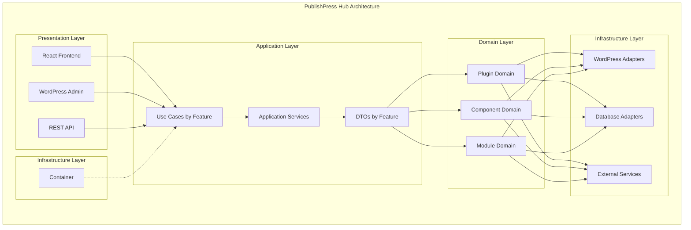
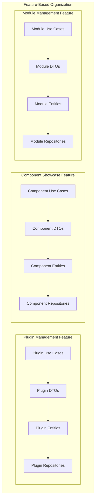
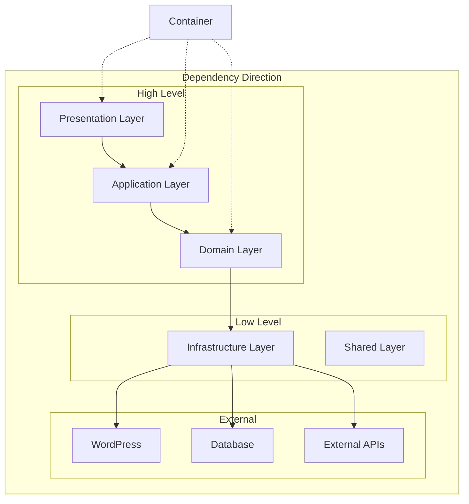

# PublishPress Hub Architecture

## Overview

PublishPress Hub implements a **Feature-Based Clean Architecture** pattern, designed for a WordPress plugin hub that serves as a central management system for multiple PublishPress plugins. This architecture combines:

- **Clean Architecture**: Clear separation of concerns with dependency inversion
- **Domain-Driven Design**: Business logic centered around domain models
- **Feature-Based Organization**: Business features organized by domain boundaries
- **WordPress Integration**: Clean abstractions over WordPress functions

## Key Principles

1. **Dependency Inversion**: High-level modules don't depend on low-level modules
2. **Single Responsibility**: Each layer has a single, well-defined responsibility
3. **Feature Organization**: Business features are organized by domain boundaries
4. **Separation of Concerns**: Clear boundaries between business logic and external concerns
5. **Testability**: Each component can be unit tested in isolation
6. **Maintainability**: Clear separation of concerns for long-term maintenance

## How It's Organized

### Complete Architecture Structure

```
src/
├── Application/                    # Use cases and application services
│   ├── UseCase/                   # Business operations by feature
│   │   ├── Plugin/                # Plugin management use cases
│   │   │   ├── InstallPluginUseCase.php
│   │   │   ├── ListPluginsUseCase.php
│   │   │   └── UpdatePluginUseCase.php
│   │   ├── Component/             # Component showcase use cases
│   │   │   ├── ShowcaseComponentUseCase.php
│   │   │   └── ListComponentsUseCase.php
│   │   └── Module/                # Module management use cases
│   │       └── BootstrapApplicationUseCase.php
│   ├── Service/                   # Application services
│   │   ├── PluginManagementService.php
│   │   ├── ComponentShowcaseService.php
│   │   └── ApplicationBootstrapService.php
│   ├── DTO/                       # Data transfer objects
│   │   ├── Plugin/                # Plugin-related DTOs
│   │   │   ├── PluginInstallationDTO.php
│   │   │   └── PluginListDTO.php
│   │   ├── Component/             # Component-related DTOs
│   │   │   └── ComponentDTO.php
│   │   └── Module/                # Module-related DTOs
│   │       └── ApplicationConfigDTO.php
│   ├── Contract/                  # Application ports/interfaces
│   │   ├── PluginRepositoryInterface.php
│   │   ├── ComponentRepositoryInterface.php
│   │   └── WordPressAdapterInterface.php
│   ├── Bootstrap/                 # Application startup
│   │   ├── ApplicationBootstrap.php
│   │   └── ModulesCoordinator.php
│   ├── Exception/                 # Application exceptions
│   │   ├── Base/                  # Base exception classes
│   │   │   ├── BaseException.php
│   │   │   ├── ErrorCodes.php
│   │   │   └── ApplicationException.php
│   │   ├── Container/             # Container-related exceptions
│   │   │   ├── ContainerException.php
│   │   │   └── DependencyNotFoundException.php
│   │   ├── UseCase/               # Use case-related exceptions
│   │   │   ├── UseCaseException.php
│   │   │   └── NotLoadedException.php
│   │   └── Service/               # Service-related exceptions
│   │       └── ServiceException.php
│   ├── AbstractDependencies.php
│   └── container-definitions.php
├── Domain/                        # Business logic and entities
│   ├── Plugin/                    # Plugin management feature
│   │   ├── Entity/
│   │   │   ├── Plugin.php
│   │   │   ├── PluginFamily.php
│   │   │   ├── FreePlugin.php
│   │   │   └── ProPlugin.php
│   │   ├── ValueObject/
│   │   │   ├── PluginVersion.php
│   │   │   ├── PluginSlug.php
│   │   │   └── PluginStatus.php
│   │   ├── Service/
│   │   │   └── PluginValidationService.php
│   │   ├── Repository/
│   │   │   └── PluginRepositoryInterface.php
│   │   └── Exception/
│   │       ├── PluginNotFoundException.php
│   │       └── PluginInstallationException.php
│   ├── Component/                 # Component showcase feature
│   │   ├── Entity/
│   │   │   └── Component.php
│   │   ├── ValueObject/
│   │   │   └── ComponentType.php
│   │   ├── Service/
│   │   │   └── ComponentValidationService.php
│   │   ├── Repository/
│   │   │   └── ComponentRepositoryInterface.php
│   │   └── Exception/
│   │       └── ComponentNotFoundException.php
│   └── Module/                    # Module management feature
│       ├── Entity/
│       │   └── Module.php
│       ├── ValueObject/
│       │   └── ModuleStatus.php
│       ├── Repository/
│       │   └── ModuleRepositoryInterface.php
│       └── Exception/
│           └── ModuleNotFoundException.php
├── Infrastructure/                # External concerns and adapters
│   ├── Container/                 # Dependency injection container
│   │   ├── definitions.php        # Main container definitions
│   │   ├── ServiceContainer.php   # Container implementation
│   │   ├── ContainerDependencies.php # Service identifiers
│   │   ├── NotFoundException.php  # Container exceptions
│   │   └── Contracts/
│   │       └── ServiceContainerInterface.php
│   ├── WordPress/
│   │   ├── Adapter/
│   │   │   ├── WordPressPluginApiAdapter.php
│   │   │   ├── WordPressHooksAdapter.php
│   │   │   ├── WordPressAdminMenuAdapter.php
│   │   │   ├── WordPressLanguageAdapter.php
│   │   │   ├── WordPressAssetAdapter.php
│   │   │   ├── WordPressDatabaseAdapter.php
│   │   │   └── WordPressRestApiAdapter.php
│   │   ├── Contract/
│   │   │   └── WordPressAdapterInterface.php
│   │   ├── Exception/
│   │   │   ├── WordPressException.php
│   │   │   └── WordPressAPIException.php
│   │   └── container-definitions.php
│   ├── Database/
│   │   ├── Adapter/
│   │   │   └── DatabasePluginRepository.php
│   │   ├── Contract/
│   │   │   └── DatabaseAdapterInterface.php
│   │   └── Exception/
│   │       ├── DatabaseException.php
│   │       └── ConnectionException.php
│   ├── External/
│   │   ├── Adapter/
│   │   │   ├── WordPressOrgApiAdapter.php
│   │   │   └── EddApiAdapter.php
│   │   ├── Contract/
│   │   │   └── ExternalAPIInterface.php
│   │   └── Exception/
│   │       ├── ExternalAPIException.php
│   │       └── NetworkException.php
│   ├── Logger/
│   │   ├── Logger.php
│   │   ├── Contract/
│   │   │   └── LoggerInterface.php
│   │   └── Exception/
│   │       ├── LoggerException.php
│   │       └── LoggingException.php
│   ├── Language/
│   │   ├── LanguageService.php
│   │   ├── Contract/
│   │   │   └── LanguageServiceInterface.php
│   │   ├── Exception/
│   │   │   └── LanguageException.php
│   │   └── container-definitions.php
│   └── Asset/
│       ├── AssetService.php
│       ├── Contract/
│       │   └── AssetServiceInterface.php
│       ├── Exception/
│       │   └── AssetException.php
│       └── container-definitions.php
├── Presentation/                  # User interface and API
│   ├── Controller/
│   │   ├── PluginController.php
│   │   ├── ComponentController.php
│   │   └── AdminController.php
│   ├── View/
│   │   ├── PluginListView.php
│   │   ├── ComponentShowcaseView.php
│   │   └── AdminView.php
│   ├── Api/
│   │   ├── PluginApiController.php
│   │   └── ComponentApiController.php
│   ├── Exception/
│   │   ├── PresentationException.php
│   │   ├── ControllerException.php
│   │   └── ViewException.php
│   └── Asset/
│       ├── css/
│       │   ├── admin-page.css
│       │   └── components.css
│       ├── jsx/
│       │   ├── components/
│       │   ├── plugins-dashboard.jsx
│       │   └── components-showcase.jsx
│       └── dist/                  # Compiled production assets
│           ├── css/
│           │   ├── admin-page.min.css
│           │   └── components.min.css
│           └── js/
│               ├── plugins-dashboard.js
│               ├── components-showcase.js
│               ├── plugins-dashboard.min.js
│               └── components-showcase.min.js
```

### Architecture Overview

The application follows **Feature-Based Clean Architecture** with domain-driven organization:



### Feature Organization

Features are organized by **domain boundaries** across all layers:



### Dependency Flow



## Layer Responsibilities

### Application Layer - Use Case Orchestration
**Purpose:** Coordinates domain operations and implements business features
- **Use Cases**: Business operations organized by feature domain (Plugin, Component, Module)
- **Services**: Orchestrate domain operations and coordinate between entities
- **DTOs**: Data structures for transferring data between layers, organized by feature
- **Contracts**: Interfaces defining service behavior and contracts

**Example:** A `InstallPluginUseCase` orchestrates the plugin installation process using Plugin domain entities.

### Domain Layer - Core Business Logic
**Purpose:** Contains the core business rules and entities organized by feature domains
- **Plugin Domain**: Plugin management business logic (Plugin, PluginFamily, FreePlugin, ProPlugin)
- **Component Domain**: Component showcase business logic (Component, ComponentType)
- **Module Domain**: Module management business logic (Module, ModuleStatus)
- **Repository Interfaces**: Contracts for data persistence operations per domain
- **Domain Services**: Business logic that doesn't belong to specific entities
- **Domain Exceptions**: Business rule violations and domain-specific errors

**Example:** A `Plugin` entity encapsulates plugin state, validation rules, and business operations within the Plugin domain.

### Infrastructure Layer - External Concerns
**Purpose:** Implements interfaces defined in higher layers
- **Repository Implementations**: Concrete database operations and data persistence
- **External Service Clients**: Integration with WordPress.org API, license servers, etc.
- **WordPress Adapters**: Clean abstractions over WordPress functions
- **Infrastructure Exceptions**: Technical errors and external service failures

**Example:** A `WordPressPluginRepository` implements the `PluginRepositoryInterface` using WordPress functions.

### Presentation Layer - User Interface
**Purpose:** Handles user interactions and data presentation
- **Controllers**: Handle HTTP requests, validate input, and coordinate responses
- **Views**: Transform domain data for presentation
- **Templates**: HTML/PHP templates for rendering user interfaces
- **Asset Management**: CSS, JavaScript, and other frontend resources

**Example:** A `PluginController` handles "Install Plugin" requests and coordinates with Plugin domain use cases.

## Feature-Based Organization Benefits

### **Plugin Management Feature**
```php
// src/Application/UseCase/Plugin/InstallPluginUseCase.php
class InstallPluginUseCase
{
    public function execute(InstallPluginRequest $request): InstallPluginResponse
    {
        $plugin = $this->pluginRepository->findBySlug($request->getSlug());

        if (!$plugin) {
            throw new PluginNotFoundException('Plugin not found');
        }

        $plugin->install();
        $this->pluginRepository->save($plugin);

        $this->wordPressAdapter->installPlugin($plugin->getSlug());

        return new InstallPluginResponse($plugin->getId(), $plugin->getStatus());
    }
}

// src/Domain/Plugin/Entity/Plugin.php
class Plugin extends Entity
{
    private PluginSlug $slug;
    private PluginVersion $version;
    private PluginStatus $status;

    public function install(): void
    {
        if (!$this->canBeInstalled()) {
            throw new PluginInstallationException('Plugin cannot be installed');
        }
        $this->status = PluginStatus::INSTALLING();
    }

    private function canBeInstalled(): bool
    {
        return $this->status->equals(PluginStatus::AVAILABLE());
    }
}
```

### **Component Showcase Feature**
```php
// src/Application/UseCase/Component/ShowcaseComponentUseCase.php
class ShowcaseComponentUseCase
{
    public function execute(ShowcaseComponentRequest $request): ShowcaseComponentResponse
    {
        $component = $this->componentRepository->findByType($request->getType());

        if (!$component) {
            throw new ComponentNotFoundException('Component not found');
        }

        return new ShowcaseComponentResponse($component->toArray());
    }
}
```

## WordPress Integration

### WordPress Abstractions
The architecture provides clean abstractions over WordPress functions:
- **API Client**: WordPress.org API integration with error handling
- **Plugin Management**: Safe plugin installation, activation, and management
- **Storage**: WordPress options and transients with type safety
- **Hooks**: Organized WordPress hooks and filters
- **User Management**: WordPress user functions with proper abstractions

### Performance Considerations
- **Lazy Loading**: Services loaded on demand
- **Caching**: Efficient data caching strategies using WordPress transients
- **Asset Optimization**: Optimized CSS/JS delivery and loading
- **Database Optimization**: Efficient database queries and connection management

## Development Guidelines

### Feature Development
1. **Start with Use Case**: Define the business operation first
2. **Define DTOs**: Create data structures for input/output within the feature
3. **Implement Domain Logic**: Add business rules to entities within the feature domain
4. **Create Infrastructure**: Implement repository and adapter classes
5. **Add Presentation**: Create controllers and views for user interaction

### Code Organization
1. **Feature-First**: Organize code by business features and domain boundaries
2. **Consistent Naming**: Use descriptive, consistent naming for classes and methods
3. **Error Handling**: Implement proper exception handling at each layer
4. **Logging**: Comprehensive logging for debugging and monitoring
5. **Security**: Input validation, sanitization, and security best practices

### Testing Strategy
1. **Unit Tests**: Test each layer independently with mocked dependencies
2. **Integration Tests**: Test feature workflows and external integrations
3. **End-to-End Tests**: Test complete user workflows and scenarios
4. **Performance Tests**: Monitor and optimize performance impact
5. **Security Tests**: Validate security measures and vulnerability prevention

## Benefits

### For Single Developer
- **Clear Structure**: Easy to understand and navigate by feature
- **Fast Development**: Less time on architecture, more on features
- **Easy Maintenance**: Simple dependency management within feature boundaries
- **Testable Code**: Business logic can be tested independently

### For Future Growth
- **Easy Module Extraction**: Clear feature boundaries make modularization simple
- **Team Onboarding**: New developers can understand the structure quickly
- **Feature Isolation**: Each feature is self-contained through domain organization
- **Scalable Architecture**: Can evolve to modular architecture when needed

### For WordPress Integration
- **Clean Abstractions**: WordPress functions are properly abstracted and testable
- **Testable Code**: Business logic can be tested without WordPress dependencies
- **Flexible Deployment**: Features can be enabled/disabled independently
- **Plugin Ecosystem**: Clear APIs for other plugins to integrate with

## Future Considerations

### Module Extraction Path
When the team grows or complexity increases, the architecture can easily evolve:

1. **Identify Feature Boundaries**: Group related use cases and domain entities
2. **Extract Module Structure**: Create module directories with Clean Architecture
3. **Move Code**: Relocate files to module-specific locations
4. **Update Namespaces**: Change namespaces to reflect module structure
5. **Create Module Bootstraps**: Add module lifecycle management

### Example Extraction
```bash
# Current feature-based structure
src/Application/UseCase/Plugin/InstallPluginUseCase.php
src/Domain/Plugin/Entity/Plugin.php
src/Infrastructure/WordPress/WordPressPluginRepository.php

# After extraction to PluginsDashboard module
src/Module/PluginsDashboard/Application/UseCase/InstallPluginUseCase.php
src/Module/PluginsDashboard/Domain/Entity/Plugin.php
src/Module/PluginsDashboard/Infrastructure/Repository/WordPressPluginRepository.php
```

## Getting Started

### For New Developers
1. **Understand the Layers**: Learn the responsibility of each layer
2. **Follow Feature Organization**: Understand how features are organized by domain
3. **Follow Use Case Pattern**: Start with business operations
4. **Use Domain Models**: Leverage entities and value objects within feature domains
5. **Write Tests**: Test your code as you write it
6. **Document**: Document your changes and architectural decisions

### For Feature Development
1. **Define the Use Case**: Identify the business operation within the feature
2. **Create DTOs**: Define input and output data structures for the feature
3. **Implement Domain Logic**: Add business rules to entities within the feature domain
4. **Build Infrastructure**: Create repository and adapter implementations
5. **Add Presentation**: Create controllers and views for user interaction

### Feature Organization Guidelines
1. **Domain Boundaries**: Keep related business concepts together
2. **Cross-Feature Dependencies**: Minimize dependencies between features
3. **Shared Code**: Extract common functionality to shared layers
4. **Feature Isolation**: Each feature should be self-contained
5. **Consistent Structure**: Maintain consistent organization across features

