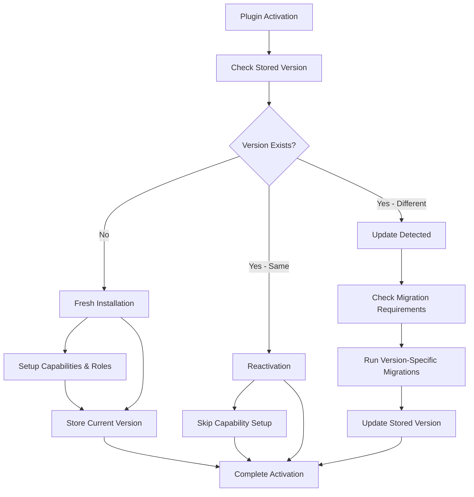

# Version Tracking System

## Overview

The PublishPress Hub plugin implements a version tracking system to manage plugin lifecycle events intelligently. This system prevents overwriting user customizations during reactivation while providing a foundation for future data migrations.

## Architecture



## Implementation

### Database Storage

The plugin version is stored in the WordPress options table:

- **Option Name**: `publishpress_hub_version`
- **Value Type**: String (semantic version format, e.g., "1.0.0")
- **Autoload**: Yes

### Service Layer

**VersionService** (`src/Application/Service/VersionService.php`)

The service receives the current version via dependency injection from the container.

### Activation Logic

**Activation Handler** (`src/activation.php`)

The activation hook determines the installation state and acts accordingly:

1. **Fresh Installation**
   - No version stored in database
   - Sets up capabilities and roles
   - Stores current version

2. **Reactivation**
   - Stored version matches current version
   - Skips capability setup to preserve user customizations
   - No database writes needed

3. **Update**
   - Stored version differs from current version
   - Runs version-specific migrations (future)
   - Updates stored version

## Migration Framework

The version tracking system provides a foundation for future data migrations:

```php
if ($versionService->isUpdate()) {
    $fromVersion = $versionService->getStoredVersionForMigration();
    $toVersion = $versionService->getCurrentVersion();

    // Run version-specific migrations
    // Example: if (version_compare($fromVersion, '2.0.0', '<')) { ... }

    $versionService->storeCurrentVersion();
}
```

## Testing Scenarios

### Scenario 1: Fresh Installation
- **State**: No option exists in database
- **Action**: Plugin activated for the first time
- **Result**: Capabilities set up, version stored

### Scenario 2: Reactivation
- **State**: Version "1.0.0" stored, current version is "1.0.0"
- **Action**: Plugin deactivated then reactivated
- **Result**: Capabilities NOT modified, user customizations preserved

### Scenario 3: Update
- **State**: Version "1.0.0" stored, current version is "1.1.0"
- **Action**: Plugin updated and activated
- **Result**: Migrations run (if any), version updated to "1.1.0"

## API Reference

### VersionService

```php
use PublishPress\Hub\Application\Service\VersionService;

// Dependency injection (in container context)
$versionService = $container->get(AbstractDependencies::VERSION_SERVICE);

// Manual instantiation (in activation context)
$optionsAdapter = new WPOptionsAdapter();
$currentVersion = defined('PUBLISHPRESS_HUB_VERSION') ? PUBLISHPRESS_HUB_VERSION : '1.0.0';
$versionService = new VersionService($optionsAdapter, $currentVersion);

// Check installation state
if ($versionService->isFreshInstall()) {
    // First-time installation logic
}

if ($versionService->isReactivation()) {
    // Skip setup to preserve customizations
}

if ($versionService->isUpdate()) {
    // Run migrations
}

// Store current version
$versionService->storeCurrentVersion();
```

## Future Enhancements

1. **Migration Service**: Create dedicated service for managing version-specific migrations
2. **Migration Registry**: Register migration callbacks for specific version ranges
3. **Rollback Support**: Store previous version for rollback scenarios
4. **Migration Logging**: Track which migrations have been executed
5. **Version Comparison Utilities**: Helper methods for semantic version comparisons

