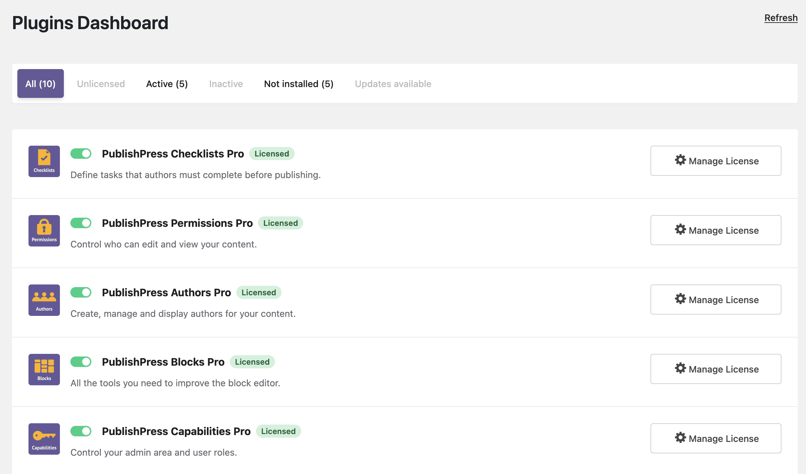
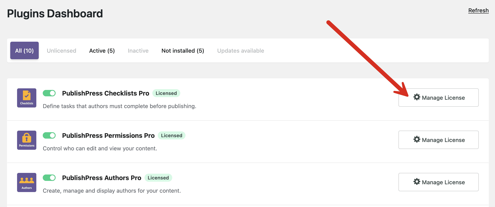
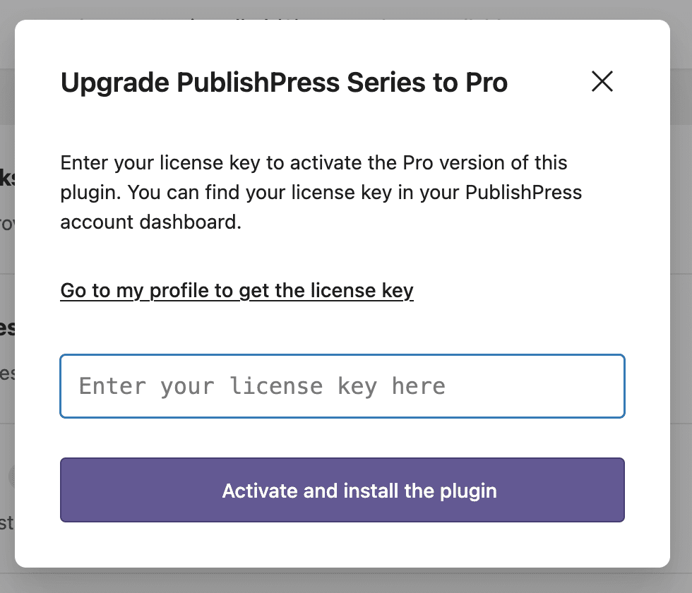
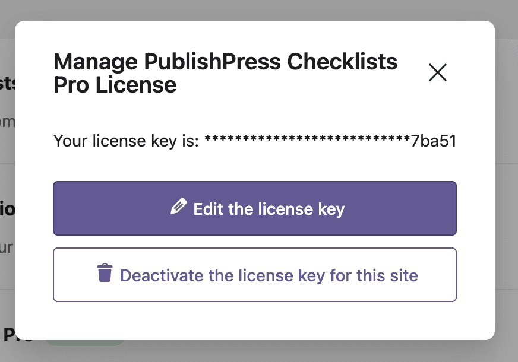

# Introducing PublishPress Hub

The PublishPress Hub plugin helps you manage all your PublishPress plugins from one central location.

You can download and install it to get started with automatic updates, license management, and more.

This plugin is **recommended, but not required**. You will find this plugin most useful if you have multiple PublishPress plugins installed on your site.

---

## How to use PublishPress Hub

Visit the “PublishPress” link in your WordPress admin menu and you’ll see the main screen for the PublishPress Hub. There are 6 tabs across the top of the screen:

* **All**: A list of every PublishPress plugin.
* **Unlicensed**: A list of any Pro plugins that do not have a valid license.
* **Active**: All the PublishPress plugins that are active on your site.
* **Inactive**: All the PublishPress plugins that are installed but not aactive on your site.
* **Not uninstalled**: All the PublishPress plugins that have not been installed on your site.
* **Updates available**: Any PublishPress plugins that have a newer version available to install.

---

## License Keys in PublishPress Hub

One key feature in PublishPress Hub is the ability to manage the license key(s) for the plugins on your site.

Next to each installed Pro plugin you will see a “Manage License” option.

If you have not entered a license key, you will be prompted to add a license key when you click “Manage License”.

If you have previously entered a license key, you will see a message showing that your license is active. You will be able replace or deactivate the license.

